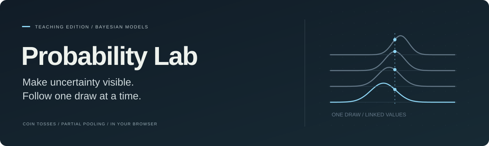
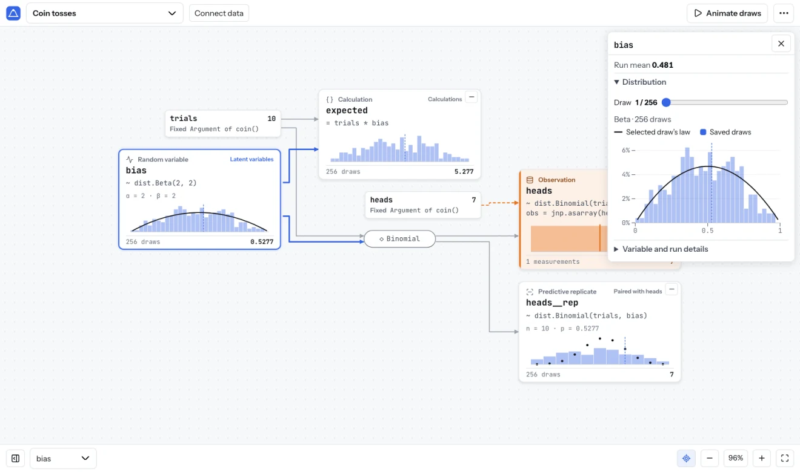

# Probability Lab · Teaching Edition

[](https://github.com/EssenceSentry/probability-lab-teaching/actions/workflows/pages.yml)
[](package.json)
[](https://essencesentry.github.io/probability-lab-teaching/)

**See how evidence changes a Bayesian model, one draw at a time.** Probability Lab connects observations, latent variables, and predictions in an interactive graph. Select a node, inspect its distribution, and follow the same draw through the calculation.

**[Open the lab →](https://essencesentry.github.io/probability-lab-teaching/)** · [Start the partial-pooling lesson](https://essencesentry.github.io/probability-lab-teaching/?lesson=pooling) · [Inspect the models](#inspect-the-models)

- **An intuition you can test.** Compare 7 heads in 10 tosses with 70 in 100: the observed proportion stays the same while uncertainty changes.
- **A concrete reason to pool.** Compare groups with the same observed mean but different sample sizes, then inspect how much each moves toward the population.
- **A small, inspectable teaching system.** Both examples use synthetic observations, saved exact-posterior draws, and visible model definitions. Exploration runs in the browser.



Try [coin tosses](https://essencesentry.github.io/probability-lab-teaching/?model=coin), then [partial pooling](https://essencesentry.github.io/probability-lab-teaching/?model=pooling). In the pooling example, compare group-location coordinates `[0]` and `[1]`: both groups average 0.6, from 2 and 40 observations respectively.

## Run locally

GitHub Actions validates both model graphs and their saved draws, checks TypeScript, and builds the app on every push and pull request. Run `npm run check:models` and `npm run build` to reproduce the checks locally.

Use Node.js 24 and npm.

```sh
npm ci
npm run dev
```

To serve the production build, run `npm run build` and `npm run preview`.

## Inspect the models

Each bundle contains the NumPyro model definition, its variables and the saved draws shown in the explorer. The coin example uses a beta-binomial model. The pooling example uses a shared normal population and a known within-group standard deviation. Each posterior run contains draws from the corresponding exact posterior.

[Coin model and draws](src/programs/coin.json) · [Partial pooling model and draws](src/programs/pooling.json)
